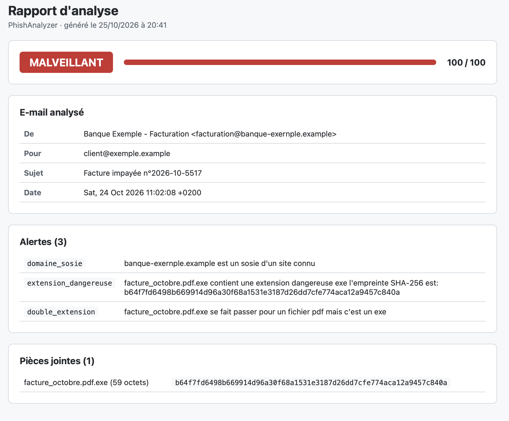

# PhishAnalyzer

Outil en ligne de commande qui analyse un e-mail suspect (fichier `.eml`) et rend un verdict argumenté : **légitime**, **suspect** ou **malveillant**. Il examine les en-têtes d'authentification, les liens et les pièces jointes, puis explique chaque indice relevé, comme le ferait un analyste SOC lors du tri d'un signalement de phishing.



Le même verdict, en ligne de commande :

```
=== PhishAnalyzer ===

De      : Banque Exemple - Facturation <facturation@banque-exernple.example>
Pour    : client@exemple.example
Sujet   : Facture impayée n°2026-10-5517
Date    : Sat, 24 Oct 2026 11:02:08 +0200

Verdict : MALVEILLANT (score 100/100)

Alertes (3) :
  [domaine_sosie] banque-exernple.example est un sosie d'un site connu
  [extension_dangereuse] facture_octobre.pdf.exe contient une extension dangereuse exe l'empreinte SHA-256 est: b64f7fd6…
  [double_extension] facture_octobre.pdf.exe se fait passer pour un fichier pdf mais c'est un exe

Pièces jointes (1) :
  facture_octobre.pdf.exe (59 octets)
  SHA-256 : b64f7fd6498b669914d96a30f68a1531e3187d26dd7cfe774aca12a9457c840a
```

## Ce que l'outil détecte

| Catégorie | Contrôle | Pourquoi c'est suspect |
|---|---|---|
| En-têtes | `reply_to` — l'adresse de réponse est sur un autre domaine | La victime croit répondre à l'expéditeur affiché, mais sa réponse part vers une boîte contrôlée par l'attaquant. |
| En-têtes | `return_path` — l'expéditeur technique est sur un autre domaine | Le champ `From` est déclaratif ; l'adresse technique trahit souvent le vrai serveur d'envoi. |
| En-têtes | `spf` — échec ou absence de vérification SPF | Le serveur qui a envoyé l'e-mail n'est pas autorisé par le domaine de l'expéditeur. |
| En-têtes | `dkim` — signature DKIM absente ou invalide | Aucune signature cryptographique ne prouve que l'e-mail vient du domaine et n'a pas été modifié. |
| En-têtes | `dmarc` — échec ou absence de vérification DMARC | Le domaine affiché dans `From` n'est validé ni par SPF ni par DKIM : c'est la signature d'une usurpation. |
| Liens | `lien_ip` — le lien pointe vers une adresse IP | Un site légitime utilise un nom de domaine ; une adresse IP sert souvent à masquer un serveur jetable. |
| Liens | `lien_trompeur` — le texte affiché ne correspond pas à la destination | La victime lit l'adresse de sa banque, mais le clic l'emmène ailleurs. |
| Liens | `domaine_sosie` — domaine qui imite un domaine connu | `banque-exernple` au lieu de `banque-exemple` : presque invisible à l'œil, et l'attaquant peut configurer SPF, DKIM et DMARC sur son propre domaine. |
| Pièces jointes | `extension_dangereuse` — fichier exécutable, script, macro… | Ces fichiers exécutent du code dès leur ouverture : c'est le vecteur classique d'installation d'un logiciel malveillant. |
| Pièces jointes | `double_extension` — extension leurre devant une extension dangereuse | Windows masque souvent la dernière extension : `facture.pdf.exe` s'affiche `facture.pdf`. |

Chaque pièce jointe est aussi identifiée par son empreinte **SHA-256**, que l'on peut rechercher sur une base de menaces comme VirusTotal.

## Le score de risque

Chaque alerte rapporte des points selon la fiabilité de l'indice (de 10 pour `return_path` à 40 pour `domaine_sosie` ou `extension_dangereuse`, barème dans [`analyzer/score.py`](analyzer/score.py)). Le total, plafonné à 100, donne le verdict :

| Score | Verdict |
|---|---|
| 0 à 19 | légitime |
| 20 à 49 | suspect |
| 50 et plus | malveillant |

Ces poids sont un point de départ raisonné. Dans un contexte réel, ils seraient ajustés sur un jeu d'e-mails déjà qualifiés (légitimes et malveillants), pour réduire à la fois les faux positifs et les faux négatifs.

## Installation

Prérequis : Python 3.9 ou plus récent. Aucune dépendance pour l'outil lui-même (bibliothèque standard uniquement).

```bash
git clone https://github.com/rkaseya/phish-analyzer.git
cd phish-analyzer
python3 -m venv .venv
source .venv/bin/activate
pip install pytest        # uniquement pour lancer les tests
```

## Utilisation

```bash
python main.py chemin/vers/email.eml
```

Pour obtenir le fichier `.eml` d'un e-mail suspect :
- **Apple Mail** : Fichier → Enregistrer sous… → format « Source du message brut » ;
- **Gmail** : menu ⋮ du message → « Télécharger le message » ;
- **Outlook** : glisser le message sur le bureau.

Trois e-mails d'exemple sont fournis dans [`samples/`](samples/) :

```bash
python main.py samples/legitime.eml               # LÉGITIME (0/100)
python main.py samples/phishing_usurpation.eml    # MALVEILLANT : usurpation + lien vers une IP
python main.py samples/phishing_piece_jointe.eml  # MALVEILLANT : domaine sosie + .pdf.exe
```

Pour enregistrer aussi un **rapport HTML**, à ouvrir dans un navigateur ou à partager :

```bash
python main.py samples/phishing_piece_jointe.eml --html rapports/facture.html
open rapports/facture.html
```

Tout le texte issu de l'e-mail (sujet, expéditeur, noms de fichiers) est échappé avant d'être inséré dans la page : un e-mail piégé ne peut pas injecter de code dans le rapport (protection contre le XSS).

Ils utilisent une banque et des domaines fictifs (`.example`, `.test`, réservés aux tests). La pièce jointe est un fichier texte inoffensif : seul son nom est piégé.

## Architecture

```
phish-analyzer/
├── main.py                 # point d'entrée : affiche le rapport
├── analyzer/
│   ├── parser.py           # lecture du fichier .eml
│   ├── headers.py          # analyse des en-têtes (Reply-To, Return-Path, SPF, DKIM, DMARC)
│   ├── links.py            # extraction et analyse des liens
│   ├── attachments.py      # analyse des pièces jointes et empreintes SHA-256
│   ├── score.py            # score de risque et verdict
│   └── rapport.py          # rapport HTML (contenu échappé contre le XSS)
├── samples/                # e-mails de test
└── tests/                  # tests automatiques (pytest)
```

Chaque module renvoie une liste d'alertes au même format, `{"code": ..., "detail": ...}` : le `code` sert au calcul du score, le `detail` est l'explication destinée à l'analyste.

## Tests

```bash
python -m pytest -v
```

61 tests couvrent chaque contrôle, sur les e-mails d'exemple et sur des cas limites (en-tête absent, pièce jointe sans nom, lien « Cliquez ici », numéro de version dans un nom de fichier, sujet piégé contre le XSS…).

## Limites

- **Authentification non revérifiée** : les résultats SPF, DKIM et DMARC sont lus dans l'en-tête `Authentication-Results` ajouté par le serveur de réception ; l'outil ne refait pas ces vérifications par requête DNS.
- **Domaines connus limités** : la détection de sosies compare les liens à une liste de marques, qui ne contient ici qu'une banque fictive. Elle ne repère pas non plus les caractères visuellement identiques d'autres alphabets (homoglyphes Unicode).
- **Contenu non analysé** : un e-mail sans lien ni pièce jointe, envoyé depuis une vraie boîte compromise, peut passer inaperçu (par exemple une fraude au président qui demande un virement). Le texte lui-même, ses formules d'urgence ou de pression, n'est pas encore analysé.
- **Pas d'analyse du contenu des fichiers** : seuls le nom et l'empreinte des pièces jointes sont examinés, pas leur contenu réel (macros d'un document Office, archive ZIP contenant un exécutable…).

## Pistes d'amélioration

- Interroger l'API **VirusTotal** avec l'empreinte SHA-256 des pièces jointes.
- Détecter les **formules d'urgence** dans le texte (« sous 24 heures », « immédiatement », « compte suspendu »).
- Vérifier les enregistrements **SPF et DMARC par requête DNS**.
- Inspecter le contenu des **archives** jointes et repérer les documents Office à macros.

## Méthode de développement

Ce projet est un projet d'apprentissage, réalisé avec l'accompagnement de Claude. Contrairement à mon projet précédent, où l'IA avait écrit la majeure partie du code, **j'ai écrit moi-même le code des modules d'analyse** : Claude m'a expliqué chaque notion, a préparé les squelettes, les tests et les e-mails d'exemple, puis a relu et commenté mon code jusqu'à ce que tous les tests passent. J'ai également écrit certains tests pour couvrir des cas limites que j'avais identifiés.

Ce que j'en retiens :
- le fonctionnement de SPF, DKIM et DMARC, et pourquoi le champ `From` ne prouve rien à lui seul ;
- les techniques courantes de phishing : usurpation, domaines sosies, liens déguisés, doubles extensions ;
- le développement piloté par les tests, et le réflexe d'écrire un test qui reproduit un bug avant de le corriger ;
- en Python : les expressions régulières, `try / except`, la manipulation de listes de dictionnaires et la gestion des valeurs absentes (`None`).
